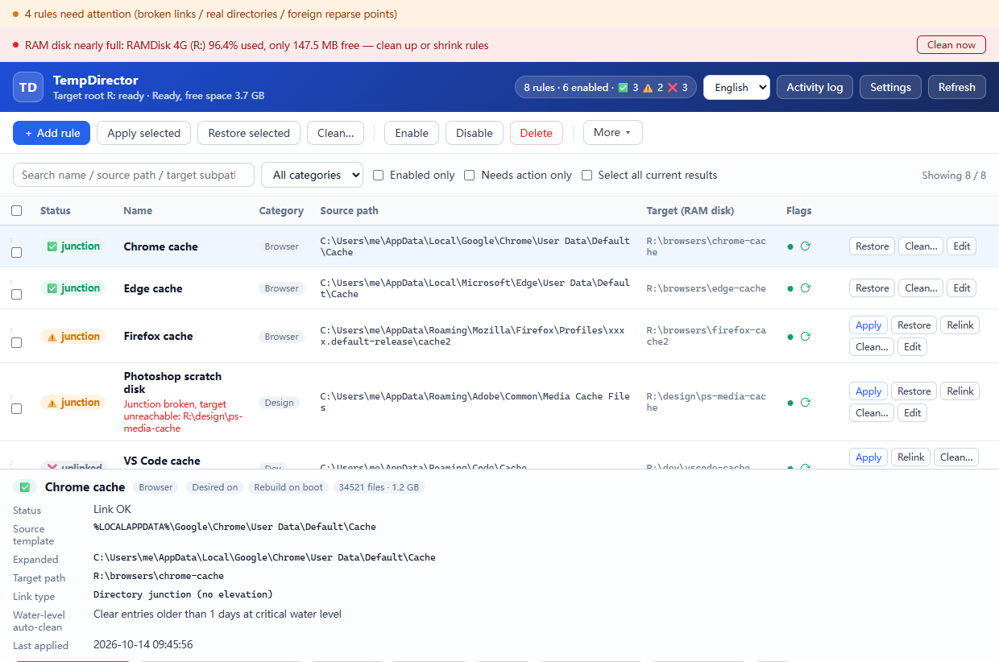
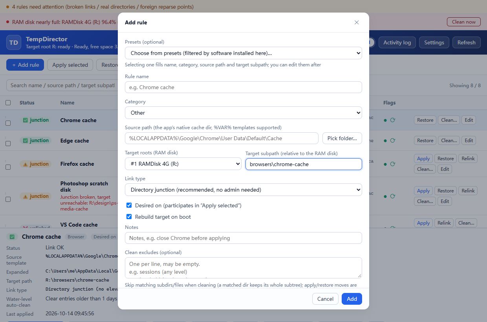
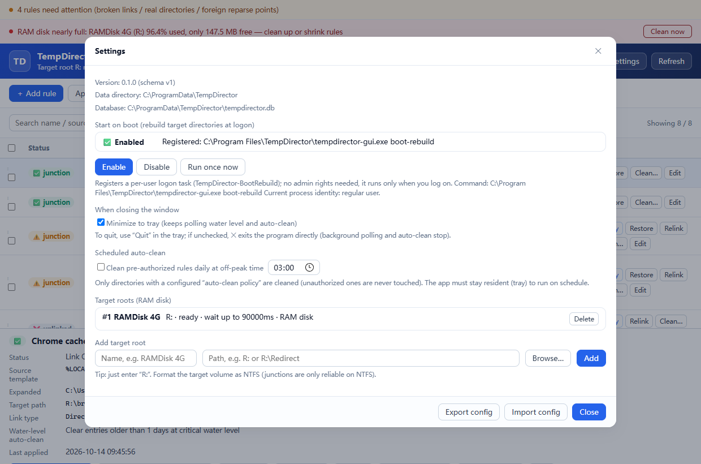
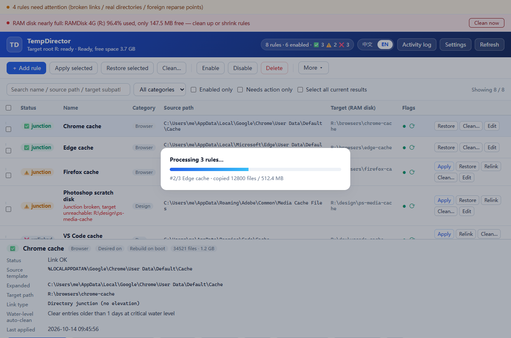

[中文](README_ZH.md) | **English**

# TempDirector

[](https://github.com/natureanalysis/TempDirector/actions/workflows/ci.yml)
[](https://github.com/natureanalysis/TempDirector/releases)
[](LICENSE)

**A Windows symbolic-link manager.** TempDirector redirects the cache and temp directories
of desktop applications to a RAM disk with directory junctions, then rebuilds that
directory tree on the RAM disk at every logon — cutting SSD writes while hot cache I/O
stays in memory. Junctions don't need `SeCreateSymbolicLinkPrivilege`, so the normal case
runs with zero UAC prompts; elevation happens on demand only when a source path sits under
`Program Files` / `ProgramData` or another protected location.

---

## Desktop UI

The UI speaks **中文 / English** — the segmented switch sits at the top right. First
launch defaults to English, and the choice is remembered.

**Main window**:



* **Rule list**: status badges (✅ OK / ⚠️ broken link or empty target / ❌ not linked /
  🚫 foreign reparse point), source → target paths side by side, wanted/boot-rebuild flags;
  search, category filter and "needs attention only" narrow the list; checked rows drive
  batch actions (apply / restore / enable / disable / relink / delete); **right-click a row**
  for the same per-row actions on that row (or on the whole checked selection, if the row is
  already checked).
  A **Size (MB)** column shows each rule's cache usage; it stays `—` until you press
  **Disk usage** in the toolbar, which fills the column in.
  Presets whose source dir exists on this machine also show up as template rows at the
  bottom of the list (badge "➕ Not added"): check one and press **Apply selected**, or use
  its own **Add & apply**, to create and link it without opening the dialog.
* **Detail panel**: full info per rule (source template and expanded path, link type,
  warnings, last applied time and size) plus single-rule actions.
* **Add / edit rule (all inline, no dialogs)**: “Add rule” inserts a blank draft row at the
  top of the list; click any cell of an existing rule to edit it in place — name, category,
  link type, source, target root + subpath, flags, auto-clean policy, capacity limit,
  excludes and notes. Enter or blur saves, Esc reverts. Source paths are expanded and validated
  inline; protected paths are marked and blocked. Changing source / target / link type on a
  linked rule prompts you to re-apply.
* **Also**: batch progress overlay, activity log, settings (autostart / scheduled cleaning /
  target roots), and a tray menu.







### Build and run

Prebuilt binaries (NSIS installer + portable zip) are on the
[Releases](https://github.com/natureanalysis/TempDirector/releases) page.

```powershell
scripts\cargo.cmd build -p td-gui --release   # output: target\release\tempdirector-gui.exe
```

The interface is static files embedded into the exe — no npm, no bundler. To preview it
without Tauri, open `crates/td-gui/ui/index.html?mock=1` in a browser (add `&progress=1` /
`&add=1` / `&settings=1` / `&ops=1` for the overlays and inline draft row).

---

## Autostart and elevation

Register a per-user logon task (no admin rights needed) to rebuild the RAM-disk tree
automatically at every logon:

```powershell
tempdirector autostart enable     # afterwards every logon rebuilds automatically
tempdirector autostart status     # inspect: registered? running what?
tempdirector autostart run        # trigger one run now, to verify
tempdirector autostart disable    # remove
```

The task action is `<GUI path> boot-rebuild`; portable setups also get `--data-dir` baked
into the task, because scheduled tasks don't inherit your shell's environment variables.
Failures are never silent: the report is stored in the database and written to
`logs/boot-rebuild.log`, and the UI shows a banner on next open.

Directory junctions themselves need no privileges, but writing caches under
`C:\Program Files` / `C:\ProgramData` / `C:\Windows` needs admin rights. Such rules are
marked in the UI, and a batch apply offers to elevate through a **one-shot worker**: a job
file containing **rule ids only — no paths**, required to live inside `<data dir>\jobs\`,
relaunching itself via `ShellExecuteExW(runas)` and re-running the exact same safety checks
as the GUI/CLI (blacklist, self-loop, occupancy detection). A job placed anywhere else is
rejected with exit code 1.

---

## Quick start

```powershell
# 1) Build (the script fills in the MSVC + Rust toolchain environment itself)
scripts\cargo.cmd build --release
# output: target\release\tempdirector.exe

# 2) Register the RAM disk as a target root
tempdirector roots add RAMDisk "R:"

# 3) Add a rule (source paths support %VAR% templates, expanded per user on import)
tempdirector rules add "Chrome cache" `
  "%LOCALAPPDATA%\Google\Chrome\User Data\Default\Cache" `
  "browsers\chrome-cache" --category browser --enable

# 4) Inspect first: health check + occupancy + dry run
tempdirector status --all
tempdirector locks "<rule id of the Chrome cache rule>"
tempdirector apply --all --dry-run

# 5) Run for real (checks occupancy first; aborts without touching anything when occupied)
tempdirector apply --all

# 6) Boot rebuild
tempdirector boot-rebuild

# 7) Undo by restoring
tempdirector restore --all
```

> The data directory defaults to `%PROGRAMDATA%\TempDirector`. Override it with the
> `TEMPDIRECTOR_DATA_DIR` environment variable or the `--data-dir` argument.

---

## Command reference

```
overview
  doctor                     environment self-check: data dir, link capability, target volumes, rule states, pending fixes
  version

target roots (RAM disk)
  roots list
  roots add <name> <path> [--timeout ms] [--hdd]
  roots rm <id>
  volume <R: or R:\Dir> [--timeout ms]        probe / wait for the volume to be ready

rules
  rules list [--enabled] [--category cat] [--search term] [--json]
  rules add <name> <source template> <target subpath> [--root id] [--category cat]
            [--link-type junction|symlink_dir] [--enable] [--no-boot] [--notes note]
  rules rm <id...>
  rules enable|disable <id...|--all>

inspection and operations
  status [--enabled|--all] [--category cat] [--search term] [--no-persist] [--json]
  locks <rule id|directory path> [--json]     check occupancy and name the process holding it
  apply <id...|--all> [--dry-run] [--merge] [--sha256] [--skip-lock-check]
  restore <id...|--all> [--dry-run] [--sha256]
  relink <id>                                 rebuild the link only (data untouched)

boot rebuild
  boot-rebuild [--json]
  autostart status                           whether the "rebuild at logon" task is registered
  autostart enable [--exe <path>]            register (per-user, no admin rights needed)
  autostart disable
  autostart run                              trigger one run manually, to verify

elevation worker (normally not needed manually)
  elevated <job.json>                        run a job as administrator (rule ids only, no paths)

config migration
  export <file.json>
  import <file.json> [--dry-run] [--ram-root R:]

audit
  events [--limit N]
  ops [--limit N]                            operation history (including pending fixes)
```

Category values: `browser` / `design` / `dev` / `system` / `media` / `office` / `game` / `other`

---

## Safety rules

1. **Never delete source content before the data check passes.** Cross-volume moves always
   go enumerate → copy → verify (file count + bytes, optional SHA-256) → delete source.
2. **Deleting a link removes only the link** — never recurse into a reparse point; doing so
   would wipe the real data on the RAM disk.
3. **Never touch what you don't understand.** Foreign reparse points (OneDrive placeholders,
   `AppExecLink`, mount points) are reported, not processed; when a software update replaces
   a link with a real directory, the boot guardian only warns and leaves it to a human.

See [`docs/ARCHITECTURE.md`](docs/ARCHITECTURE.md) (Chinese) for 20+ edge cases.

---

## Repository layout

```
crates/
  td-core/                 engine library (no GUI dependencies)
    src/util.rs            path normalization, \\?\ long paths, env var expansion, volume detection
    src/safety.rs          rule blacklist (volume roots / system dirs / self-loops)
    src/link/              reparse point identification, Junction create/remove
    src/fsops/             occupancy detection (+Restart Manager), safe moving, merging, verification
    src/engine.rs          orchestration: decision tree → move → link → rollback → persist
    src/store/             SQLite schema / migrations / DAO / operation history
    src/boot/              waiting for volume readiness, batch rebuild at boot, DACL re-apply
    src/autostart.rs       logon task register / query / remove (schtasks + task XML)
    src/elevate.rs         elevation state detection, launching a process as admin and waiting
    src/worker.rs          the elevation worker's job protocol and executor (the trust anchor)
    src/portable.rs        config import / export
    presets.json           built-in preset list (cache dirs of common apps, embedded at compile time)
  td-cli/                  tempdirector.exe (management / elevation worker / boot rebuild)
  td-gui/                  tempdirector-gui.exe (Tauri 2 UI)
    src/api.rs             business layer: takes &Store, emits serde structs (unit-testable without a window)
    src/commands.rs        thin #[tauri::command] forwarding + progress events + folder dialog
    src/submode.rs         headless submodes: boot-rebuild / elevated (intercepted before Tauri)
    src/lib.rs             entry: submodes → in-memory store fallback → mark_stale_ops → register commands
    src/tray.rs            tray menu (show window / rebuild now / quit)
    ui/                    index.html / style.css / app.js (static files, embedded at compile time)
docs/ARCHITECTURE.md       architecture and edge cases (Chinese)
docs/screenshots/          UI screenshots (one Chinese set + one English set: main-window / add-rule / settings / progress)
scripts/cargo.cmd          dev build wrapper (fills in MSVC + Rust environment)
scripts/make_icon.py       app icon generation (pure PIL, re-runnable)
scripts/take-screens.cjs   UI screenshot generation (mock data + headless browser, Chinese and English sets, re-runnable)
rebuild.bat                one-click full rebuild (clean + release) and desktop shortcut refresh
```

---

## Preset rules

The "Add rule" dialog offers a **preset dropdown** with cache-directory templates for
common apps, merged from two layers:

1. **Built-in** — `crates/td-core/presets.json`, embedded at compile time (editing it
   requires a rebuild).
2. **User-external** — `presets.json` in the data directory (`%PROGRAMDATA%\TempDirector`,
   or the `TEMPDIRECTOR_DATA_DIR` directory in portable mode). Same format, no rebuild:

```json
[
  {
    "name": "My app cache",
    "category": "dev",
    "source_template": "%LOCALAPPDATA%\\MyApp\\Cache",
    "target_subpath": "dev\\myapp-cache",
    "note": "optional hint"
  }
]
```

A user entry whose `source_template` matches a built-in one (case-insensitive)
**overrides** it; the rest are appended. Only entries whose source directory actually
exists on this machine are shown. The chain is covered by the integration test
`crates/td-gui/tests/preset_override.rs`.

---

Besides the dialog dropdown, presets whose source directory exists on this machine are
rendered **directly as template rows at the bottom of the rule list** (badge "➕ Not added"):
check one and press **Apply selected**, or click the row's own **Add & apply**, to create and
link it with the template defaults (junction, wanted on, rebuild on boot) — no dialog, no
manual add step. Templates matching a `source_template` that already has a rule are hidden.

## Development

```powershell
scripts\cargo.cmd check --workspace --all-targets
scripts\cargo.cmd test  --workspace          # 186 tests (unit: td-core 165, td-cli 11, td-gui 6; integration: 4)
scripts\cargo.cmd build --release            # both exes at once
rebuild.bat                                  # full rebuild: clean + release + refresh the desktop shortcut
python scripts\make_icon.py                  # regenerate the app icon
```

`scripts/cargo.cmd` wraps cargo to fill in the MSVC + Rust toolchain environment
(`vcvars64.bat`, `PATH`, `RUSTUP_HOME` / `CARGO_HOME`); keep it pure ASCII — `cmd.exe`
reads batch files with an OEM code page. `rebuild.bat` also refreshes the desktop shortcut
after a clean rebuild, since `cargo clean` wipes `target\` and any earlier .lnk would
dangle.

Retaking the UI screenshots for this README (mock data + headless browser, no Tauri):

```powershell
# requires playwright (npm i playwright); uses the Edge / Chrome already installed
node scripts\take-screens.cjs --lang en     # English set
node scripts\take-screens.cjs --lang zh     # Chinese set
node scripts\take-screens.cjs --lang en --check   # scan for missing translations only
```

### About the tauri version

Pin the whole family together — `tauri 2.11.5 / tauri-build 2.6.3 / tauri-codegen 2.6.3 /
tauri-macros 2.6.3 / tauri-plugin 2.6.3 / tauri-utils 2.9.3 / tauri-runtime 2.11.3 /
tauri-runtime-wry 2.11.4 / wry 0.55.1`. The transitive crates are range dependencies, so
bumping only the main crate breaks the build with errors like
`no variant named UnexpectedMenuKind`; move the whole set with `cargo update -p <crate>
--precise <ver>`.
