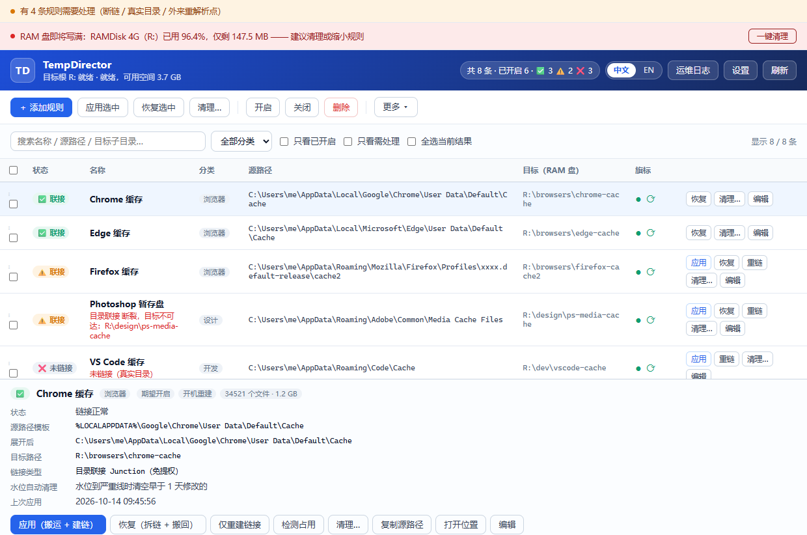
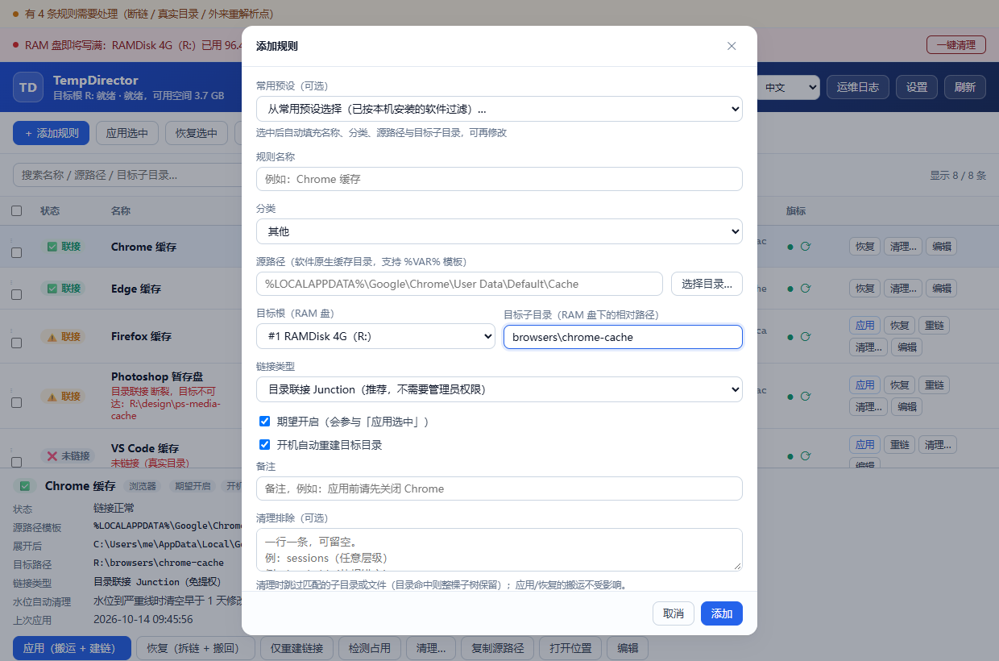
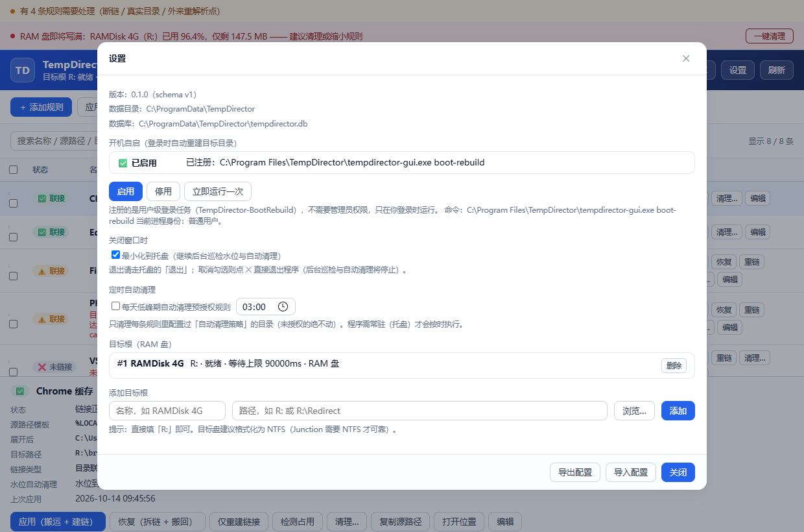
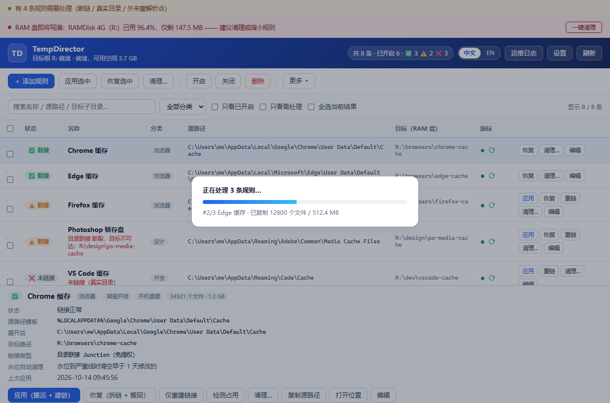

**中文** | [English](README.md)

# TempDirector

[](https://github.com/natureanalysis/TempDirector/actions/workflows/ci.yml)
[](https://github.com/natureanalysis/TempDirector/releases)
[](LICENSE)

**一款 Windows 软链接管理软件。** TempDirector 用目录 Junction 把上百款桌面软件的
缓存 / 临时目录重定向到 RAM 盘，并在每次登录后把 RAM 盘上的目录树重建出来 —— 既减少
SSD 写入，又让高频缓存读写发生在内存里。Junction 不需要 `SeCreateSymbolicLinkPrivilege`，
常规场景零 UAC 弹窗；只有源路径位于 `Program Files` / `ProgramData` 等受保护位置时才按需提权。

---

## 桌面界面

界面支持 **中文 / English**：右上角分段按钮切换，首次启动默认英文，选择会记住。

**主界面**：



* **规则列表**：状态徽标（✅ 正常 / ⚠️ 断链或目标空 / ❌ 未链接 / 🚫 外来重解析点）、
  源路径 → 目标路径并排、期望开关与开机重建旗标；搜索、分类筛选、只看需处理快速收敛；
  勾选后批量操作（应用 / 恢复 / 开启 / 关闭 / 仅重建链接 / 删除）；**在行上右键**可就地对该条
  （若该条已勾选，则对已勾选的一批）执行同样的行级操作。
  **「占用(M)」列**显示每条规则缓存目录的当前占用（MB），点工具栏「空间统计」后回填，未统计时显示 `—`。
  列表末尾直接列出本机可用的**内置模板**（带「➕ 未添加」标记），勾选后随「应用选中」
  一并建规则 + 建链，不必先开弹窗手动添加。
* **详情面板**：单条规则的完整信息（源模板与展开路径、链接类型、警告、上次应用时间与规模）+
  单条操作按钮。
* **添加 / 编辑规则（全部在列表里完成，不弹对话框）**：点「添加规则」会在列表顶部插入一条
  空白草稿行，直接在行内填写；已有规则单击任意字段单元格即可编辑（名称 / 分类 / 链接类型 /
  源路径 / 目标根与子目录 / 旗标 / 自动清理策略 / 容量上限 / 排除 / 备注），回车或失焦保存，
  Esc 撤销。源路径在单元格内实时展开校验，受保护路径会标红并阻止保存；已建链规则改源 / 目标 /
  链接类型后会提示重新应用。列表末尾直显的内置模板行同样出自预设清单，点名称可直接预填到
  草稿行改后再存，勾选后也可一步建规则 + 建链。一格还没回车就直接点下一格时，会先保存旧格
  再打开新格；保存 / 刷新后保持滚动位置和焦点。
* **其他**：批量进度浮层、运维日志、设置（开机自启 / 定时清理 / 目标根）、托盘菜单。







### 构建与运行

不想编译？[Releases](https://github.com/natureanalysis/TempDirector/releases) 页面直接下载
NSIS 安装包或便携 ZIP。

```powershell
scripts\cargo.cmd build -p td-gui --release   # 产物：target\release\tempdirector-gui.exe
```

界面是编译期内嵌进 exe 的静态文件，不需要 npm / 打包器。想不启动 Tauri 单独预览，
直接在浏览器里打开 `crates/td-gui/ui/index.html?mock=1`（加 `&progress=1` / `&add=1` /
`&settings=1` / `&ops=1` 看各浮层与行内新增草稿）。

---

## 开机自启与提权

注册一个用户级登录任务（不需要管理员权限），即可在每次登录后自动重建 RAM 盘目录树：

```powershell
tempdirector autostart enable     # 之后每次登录自动重建
tempdirector autostart status     # 查看是否已注册、跑的是什么命令
tempdirector autostart run        # 立刻触发一次，验证配置
tempdirector autostart disable    # 移除
```

任务动作是 `<GUI 路径> boot-rebuild`；便携模式会把 `--data-dir` 一并写进任务（任务计划
不继承 shell 环境变量）。失败不会静默：报告落库并写 `logs/boot-rebuild.log`，界面下次
打开时在顶部横幅提示。

目录 Junction 本身免特权，但写 `C:\Program Files` / `C:\ProgramData` / `C:\Windows` 下的
缓存需要管理员权限。这类规则在界面上带标记，批量应用时会询问是否提权。提权走**一次性
worker**：job 文件**只含规则 id、不含路径**，必须位于 `<数据目录>\jobs\` 内，由
`ShellExecuteExW(runas)` 拉起自身，并重跑与 GUI/CLI 完全相同的安全校验（黑名单、自环、
占用检测）；放到别处会以退出码 1 被拒。

---

## 快速开始

```powershell
# 1) 编译（脚本会自己补齐 MSVC + Rust 工具链环境）
scripts\cargo.cmd build --release
# 产物：target\release\tempdirector.exe

# 2) 注册 RAM 盘作为目标根
tempdirector roots add RAMDisk "R:"

# 3) 加一条规则（源路径支持 %VAR% 模板，导入库时按当前用户展开）
tempdirector rules add "Chrome 缓存" `
  "%LOCALAPPDATA%\Google\Chrome\User Data\Default\Cache" `
  "browsers\chrome-cache" --category browser --enable

# 4) 先看体检结果 + 占用情况 + 预演
tempdirector status --all
tempdirector locks "Chrome 缓存对应的规则 id"
tempdirector apply --all --dry-run

# 5) 真正执行（会先检测占用，被占用就中止且不做任何改动）
tempdirector apply --all

# 6) 开机重建
tempdirector boot-rebuild

# 7) 想撤销就恢复
tempdirector restore --all
```

> 数据目录默认是 `%PROGRAMDATA%\TempDirector`，可用环境变量 `TEMPDIRECTOR_DATA_DIR`
> 或参数 `--data-dir` 覆盖。

---

## 命令一览

```
概览
  doctor                     环境自检：数据目录、链接能力、目标盘、规则状态、待修复项
  version

目标根（RAM 盘）
  roots list
  roots add <名称> <路径> [--timeout 毫秒] [--hdd]
  roots rm <id>
  volume <R: 或 R:\Dir> [--timeout 毫秒]        探测 / 等待卷就绪

规则
  rules list [--enabled] [--category 分类] [--search 关键词] [--json]
  rules add <名称> <源路径模板> <目标子目录> [--root id] [--category 分类]
            [--link-type junction|symlink_dir] [--enable] [--no-boot] [--notes 备注]
  rules rm <id...>
  rules enable|disable <id...|--all>

体检与操作
  status [--enabled|--all] [--category 分类] [--search 关键词] [--no-persist] [--json]
  locks <规则id|目录路径> [--json]              检测占用并指出是哪个进程占着
  apply <id...|--all> [--dry-run] [--merge] [--sha256] [--skip-lock-check]
  restore <id...|--all> [--dry-run] [--sha256]
  relink <id>                                  只重建链接（不动数据）

开机重建
  boot-rebuild [--json]
  autostart status                           查看"登录时自动重建"任务是否已注册
  autostart enable [--exe <路径>]            注册（用户级，不需要管理员权限）
  autostart disable
  autostart run                              立刻手动触发一次，验证配置

提权 worker（一般不需要手动调）
  elevated <job.json>                        以管理员身份执行一份 job（只认规则 id，不认路径）

配置迁移
  export <文件.json>
  import <文件.json> [--dry-run] [--ram-root R:]

审计
  events [--limit N]
  ops [--limit N]                              操作流水（含待修复项）
```

分类取值：`browser` / `design` / `dev` / `system` / `media` / `office` / `game` / `other`

---

## 三条不可动摇的安全铁律

1. **数据核对通过之前，绝不删除源目录内容。**
   跨卷搬运的顺序固定是：枚举 → 复制 → 核对（文件数 + 总字节，可选 SHA-256）→ 才删源。
2. **删除链接只允许删链接条目本身，任何情况下不得对重解析点递归删除。**
   违反这条会直接删掉 RAM 盘里的真实数据。
3. **看不懂的东西一律不动。**
   外来重解析点（OneDrive 占位符、`AppExecLink`、卷挂载点）只报告、不处理；软件更新把
   链接覆盖成真实目录后，开机守护只报警告交给人处理。

细节（含 20+ 条边界条件）见 [`docs/ARCHITECTURE.md`](docs/ARCHITECTURE.md)。

---

## 目录结构

```
crates/
  td-core/                 内核库（无 GUI 依赖）
    src/util.rs            路径归一化、\\?\ 长路径、环境变量展开、卷判定
    src/safety.rs          规则黑名单（卷根 / 系统目录 / 自环）
    src/link/              重解析点识别、Junction 建/拆
    src/fsops/             占用检测(+Restart Manager)、安全搬运、合并、核对
    src/engine.rs          编排：决策树 → 搬运 → 建链 → 回滚 → 落库
    src/store/             SQLite schema / 迁移 / DAO / 操作流水
    src/boot/              等待卷就绪、开机批量重建、DACL 回灌
    src/autostart.rs       登录任务的注册 / 查询 / 取消（schtasks + 任务 XML）
    src/elevate.rs         提权状态判定、以管理员身份拉起进程并等待
    src/worker.rs          提权 worker 的 job 协议与执行体（信任锚在这里）
    src/portable.rs        配置导入导出
    presets.json           内置预设清单（常用软件缓存目录，编译时内嵌）
  td-cli/                  tempdirector.exe（管理 / 提权 worker / 开机重建）
  td-gui/                  tempdirector-gui.exe（Tauri 2 界面）
    src/api.rs             业务层：只吃 &Store、吐 serde 结构体（可脱离窗口单测）
    src/commands.rs        #[tauri::command] 薄转发 + 进度事件 + 目录选择框
    src/submode.rs         无界面子模式：boot-rebuild / elevated（在 Tauri 之前拦下）
    src/lib.rs             入口：子模式 → 降级内存库 → mark_stale_ops → 注册命令
    src/tray.rs            托盘菜单（显示窗口 / 立即重建 / 退出）
    ui/                    index.html / style.css / app.js（静态文件，编译时内嵌）
docs/ARCHITECTURE.md       架构与边界条件
docs/screenshots/          界面截图（中英各一套：main-window / add-rule / settings / progress）
scripts/cargo.cmd          开发构建包装（自动补 MSVC + Rust 环境）
scripts/make_icon.py       应用图标生成（纯 PIL 绘制，可重跑）
scripts/take-screens.cjs   界面截图生成（mock 数据 + 无头浏览器，中英各一套，可重跑）
rebuild.bat                一键全量重建（clean + release）并刷新桌面快捷方式
```

---

## 预设规则

「添加规则」改为**列表顶部的草稿行**（不再有表单弹窗），内置预设与用户外置预设都会作为
列表末尾的模板行出现；直接勾选模板行即可建规则 + 建链。预设合并两层：

1. **内置**：`crates/td-core/presets.json`，编译期内嵌（改它需要重新编译）。
2. **用户外置**：数据目录下的 `presets.json`（默认 `%PROGRAMDATA%\TempDirector`，便携模式
   用 `TEMPDIRECTOR_DATA_DIR` 指向的目录）。格式与内置完全一致，无需重新编译：

```json
[
  {
    "name": "我的软件缓存",
    "category": "dev",
    "source_template": "%LOCALAPPDATA%\\MyApp\\Cache",
    "target_subpath": "dev\\myapp-cache",
    "note": "可选：给用户看的提示"
  }
]
```

`source_template` 相同（忽略大小写）的用户条目**覆盖**内置条目，其余**追加**。两层都只
展示**本机实际存在源目录**的条目。这条链路有集成测试
`crates/td-gui/tests/preset_override.rs` 真实验证。

---

除弹窗顶部下拉外，**本机实际存在的内置 / 外置预设会直接作为模板行显示在规则列表末尾**
（带「➕ 未添加」标记）：勾选后点「应用选中」，或直接点该行的「添加并应用」，即按模板默认值
（junction、期望开启、开机重建）建规则并建链 —— 无需先打开弹窗，也无需先手动添加。已存在同
`source_template` 规则的模板不再重复显示。

## 开发

```powershell
scripts\cargo.cmd check --workspace --all-targets
scripts\cargo.cmd test  --workspace          # 共 186 个测试（单元：td-core 165、td-cli 11、td-gui 6；集成：4）
scripts\cargo.cmd build --release            # 两个 exe 一起出
rebuild.bat                                  # 全量重建：clean + release + 刷新桌面快捷方式
python scripts\make_icon.py                  # 需要改图标时重跑
```

`scripts/cargo.cmd` 负责在转发给 cargo 前补齐 MSVC + Rust 工具链环境（`vcvars64.bat`、
`PATH`、`RUSTUP_HOME` / `CARGO_HOME`）；它必须保持纯 ASCII —— `cmd.exe` 用 OEM 码页读
批处理。`rebuild.bat` 在 clean 重建后会刷新桌面快捷方式，因为 `cargo clean` 会连 `target\`
一起清掉，之前的 .lnk 会悬空。

重拍 README 用的界面截图（不启动 Tauri，mock 数据 + 无头浏览器，中英各一套）：

```powershell
# 依赖 playwright（npm i playwright），浏览器用系统已安装的 Edge / Chrome
node scripts\take-screens.cjs --lang en     # 英文四张
node scripts\take-screens.cjs --lang zh     # 中文四张
node scripts\take-screens.cjs --lang en --check   # 只扫漏翻（汉字 / 裸键名），不截图
```

### 关于 tauri 版本：整个家族必须锁在同一代

必须整套锁死 —— `tauri 2.11.5 / tauri-build 2.6.3 / tauri-codegen 2.6.3 /
tauri-macros 2.6.3 / tauri-plugin 2.6.3 / tauri-utils 2.9.3 / tauri-runtime 2.11.3 /
tauri-runtime-wry 2.11.4 / wry 0.55.1`。这些间接依赖都是范围依赖，只升级主 crate 会编译
报错（如 `no variant named UnexpectedMenuKind`）；升级时用
`cargo update -p <crate> --precise <ver>` 整套一起动。
